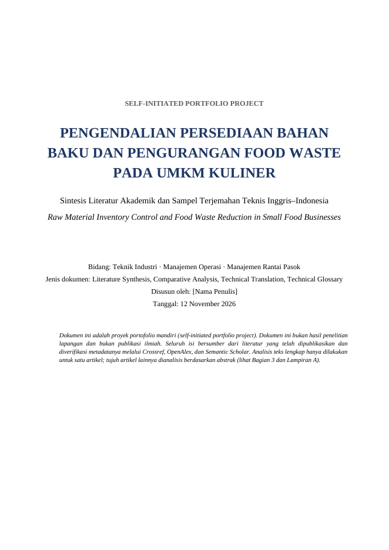
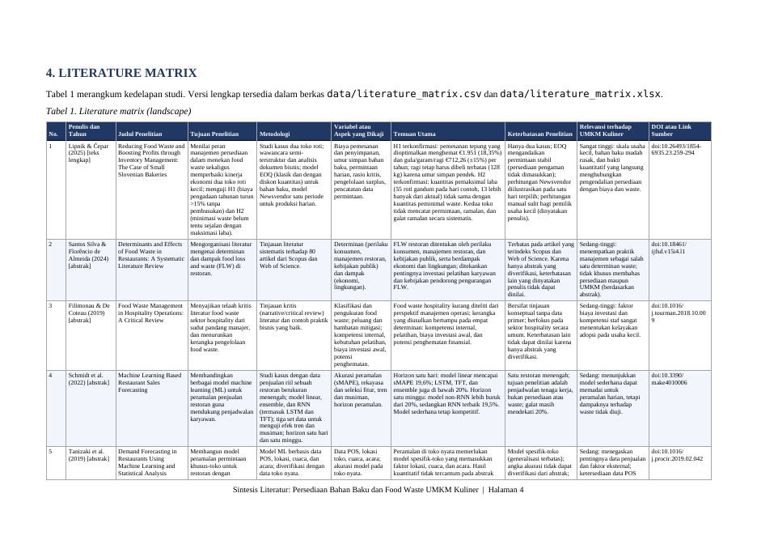
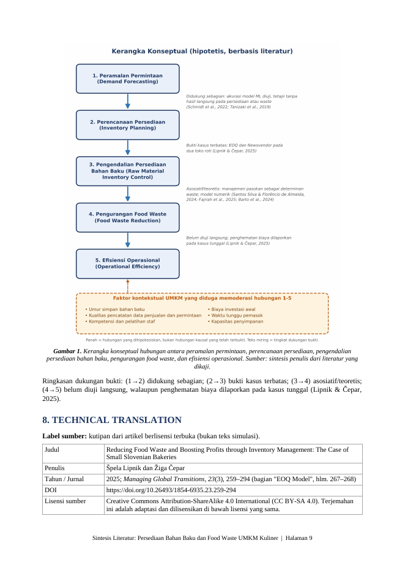

# Sintesis Literatur: Pengendalian Persediaan Bahan Baku dan Pengurangan Food Waste pada UMKM Kuliner

Proyek portofolio mandiri (*self-initiated*) di bidang Teknik Industri, Manajemen Operasi, dan Manajemen Rantai Pasok. Proyek ini menggabungkan **sintesis literatur akademik** dan **terjemahan teknis Inggris–Indonesia**. Proyek ini **bukan** penelitian lapangan dan bukan publikasi ilmiah.

## Tujuan

Memahami bagaimana pengendalian persediaan dan peramalan permintaan dapat membantu UMKM kuliner mengurangi pemborosan bahan baku sekaligus meningkatkan efisiensi operasional.

## Isi dan fitur

- Laporan 13 halaman: ringkasan eksekutif, metodologi pencarian, literature matrix (8 studi, 10 kolom), sintesis tematik dan analisis komparatif, *research gap*, kerangka konseptual berbasis bukti, terjemahan teknis (±245 kata), glosarium 21 istilah, kesimpulan, daftar pustaka APA 7, dan laporan keterbatasan sumber.
- Seluruh sumber diverifikasi terhadap Crossref (judul, penulis, tahun, volume, halaman, DOI) oleh `scripts/verify_references.py`.
- Kutipan Inggris pada terjemahan dicocokkan kalimat demi kalimat dengan PDF sumber (CC BY-SA 4.0).

## Keluaran

| Berkas | Keterangan |
|---|---|
| `dist/Laporan_Sintesis_Literatur.docx` | Laporan utama (DOCX) |
| `dist/Laporan_Sintesis_Literatur.pdf` | Versi PDF |
| `report/laporan_sintesis_literatur.md` | Sumber Markdown |
| `data/literature_matrix.csv`, `.xlsx` | Literature matrix |
| `data/references.json`, `data/literature_matrix.json` | Data terstruktur (sumber tunggal) |
| `docs/verification_report.md` | Hasil verifikasi otomatis |

## Cuplikan

| Sampul | Literature matrix | Kerangka konseptual dan terjemahan |
|---|---|---|
|  |  |  |

## Teknologi

Python 3 (python-docx, openpyxl, matplotlib), Pandoc, LibreOffice (konversi PDF). Tidak ada API key atau kredensial; seluruh pemanggilan memakai API publik Crossref. Karena itu tidak diperlukan `.env.example`.

## Instalasi dan penggunaan

```bash
pip install -r requirements.txt
```

```bash
python3 scripts/build_matrix.py      # CSV dan XLSX
python3 scripts/build_figure.py      # kerangka konseptual (PNG)
python3 scripts/build_docx.py        # DOCX dan PDF ke dist/
python3 scripts/verify_references.py # verifikasi DOI dan sitasi (opsional: --source-txt teks-PDF-sumber.txt)
```

Prasyarat sistem: `pandoc` dan `soffice` (LibreOffice) pada PATH.

## Sumber yang dikaji

Delapan artikel (Lipnik & Čepar, 2025; Santos Silva & Florêncio de Almeida, 2024; Filimonau & De Coteau, 2019; Schmidt et al., 2022; Tanizaki et al., 2019; Chaudhary et al., 2018; Barto et al., 2024; Fajriah et al., 2025). Daftar lengkap ada pada Bagian 11 laporan.

## Keterbatasan dan asumsi

- **Hanya satu artikel (Lipnik & Čepar, 2025) yang dibaca teks lengkapnya.** Tujuh artikel lain dianalisis dari abstrak yang diverifikasi karena akses teks lengkap dibatasi.
- Dua artikel relevan dikeluarkan karena abstraknya tidak dapat diverifikasi.
- Korpus kecil dan bukan tinjauan sistematis lengkap; Google Scholar, Scopus, dan Web of Science tidak digunakan langsung.
- Tidak ada studi UMKM kuliner Indonesia dalam korpus; ini keterbatasan pencarian, bukan bukti ketiadaan literatur.
- Panjang laporan (13 halaman) melebihi target 5–8 halaman karena literature matrix landscape, glosarium, dan terjemahan dihitung dalam isi utama; badan analitis utama sekitar 8–9 halaman.
- Nama penulis pada sampul masih berupa placeholder `[Nama Penulis]`.

## Lisensi dan atribusi

Kutipan terjemahan pada Bagian 8 diadaptasi dari Lipnik & Čepar (2025), CC BY-SA 4.0 (https://creativecommons.org/licenses/by-sa/4.0/); terjemahan tersebut dilisensikan dengan lisensi yang sama. Selebihnya konten laporan merupakan karya penulis proyek ini.
