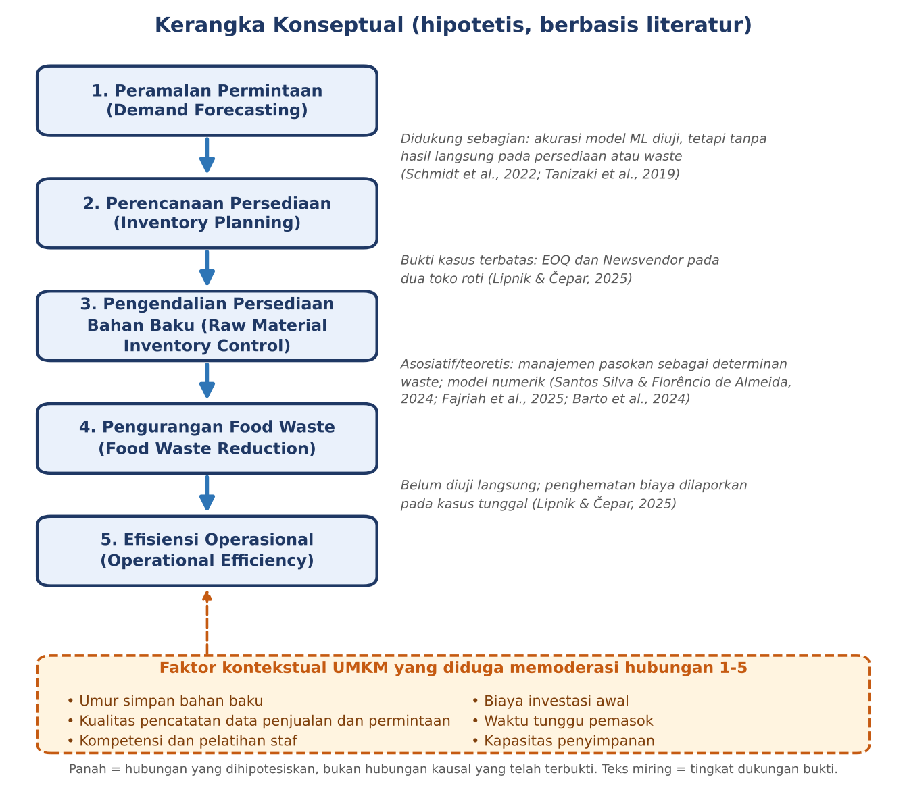

::: {custom-style="CoverTop"}
SELF-INITIATED PORTFOLIO PROJECT
:::

::: {custom-style="CoverTitle"}
PENGENDALIAN PERSEDIAAN BAHAN BAKU DAN PENGURANGAN FOOD WASTE PADA UMKM KULINER
:::

::: {custom-style="CoverSub"}
Sintesis Literatur Akademik dan Sampel Terjemahan Teknis Inggris–Indonesia
:::

::: {custom-style="CoverSub"}
*Raw Material Inventory Control and Food Waste Reduction in Small Food Businesses*
:::

::: {custom-style="CoverMeta"}
Bidang: Teknik Industri · Manajemen Operasi · Manajemen Rantai Pasok\
Jenis dokumen: Literature Synthesis, Comparative Analysis, Technical Translation, Technical Glossary\
Disusun oleh: Steven\
Tanggal: 12 November 2026
:::

::: {custom-style="CoverNote"}
Dokumen ini adalah proyek portofolio mandiri (*self-initiated portfolio project*). Dokumen ini bukan hasil penelitian lapangan dan bukan publikasi ilmiah. Seluruh isi bersumber dari literatur yang telah dipublikasikan dan diverifikasi metadatanya melalui Crossref, OpenAlex, dan Semantic Scholar. Analisis teks lengkap hanya dilakukan untuk satu artikel; tujuh artikel lainnya dianalisis berdasarkan abstrak (lihat Bagian 3 dan Lampiran A).
:::

```{=openxml}
<w:p><w:r><w:br w:type="page"/></w:r></w:p>
```

# 1. EXECUTIVE SUMMARY

Usaha mikro, kecil, dan menengah (UMKM) kuliner mengelola bahan baku yang cepat rusak dengan permintaan harian yang berfluktuasi, sementara sumber daya analitis mereka terbatas. Laporan ini menyintesis delapan publikasi akademik (2018–2025) untuk menjawab satu pertanyaan: bagaimana pengendalian persediaan dan peramalan permintaan dapat membantu UMKM kuliner mengurangi pemborosan bahan baku sekaligus meningkatkan efisiensi operasional?

Temuan utama sintesis:

1. **Pengendalian persediaan terbukti bermanfaat pada tingkat kasus, tetapi bukti empiris untuk usaha mikro-kecil masih sangat tipis.** Satu-satunya studi empiris berskala kecil dalam korpus ini, studi dua toko roti Slovenia, melaporkan penghematan biaya pengadaan sekitar 15–18% melalui model *Economic Order Quantity* (EOQ) tanpa menimbulkan pembusukan bahan (Lipnik & Čepar, 2025).
2. **Meminimalkan *food waste* tidak identik dengan memaksimalkan laba.** Model Newsvendor pada studi yang sama menunjukkan bahwa kuantitas produksi pemaksimal laba dapat melebihi permintaan yang diharapkan (Lipnik & Čepar, 2025).
3. **Peramalan permintaan berbasis data penjualan sudah dapat dilakukan dengan akurasi yang wajar**, dan model sederhana tetap kompetitif (Schmidt et al., 2022). Namun, tidak ada studi dalam korpus ini yang menguji secara langsung dampak akurasi ramalan terhadap volume *food waste*.
4. **Tinjauan sistematis dan naratif menempatkan praktik manajemen, termasuk manajemen pasokan, sebagai determinan *food waste* restoran**, di samping perilaku konsumen dan kebijakan publik (Fajriah et al., 2025; Santos Silva & Florêncio de Almeida, 2024). Bukti ini bersifat asosiatif, bukan kausal.
5. **Hambatan implementasi pada UMKM** mencakup kompetensi staf, biaya investasi awal, ketiadaan pencatatan data permintaan, dan kerumitan perhitungan manual (Filimonau & De Coteau, 2019; Lipnik & Čepar, 2025).

Laporan ini juga memuat literature matrix, analisis komparatif, *research gap*, kerangka konseptual berbasis bukti, terjemahan teknis berlisensi CC BY-SA 4.0 (±230 kata), glosarium 21 istilah, dan laporan verifikasi sumber.

# 2. PENDAHULUAN

*Food waste* di rantai pasok pangan dipandang memiliki implikasi ekonomi, lingkungan, dan etika yang besar (Lipnik & Čepar, 2025). Pada produk dengan umur simpan pendek, seperti roti, pemborosan terutama bersumber dari produksi berlebih dan persediaan yang tidak terjual (Lipnik & Čepar, 2025). Bahan baku segar bersifat *perishable*: kelebihan stok berisiko menjadi limbah, sedangkan kekurangan stok menyebabkan penjualan hilang dan, pada beberapa kasus, pembelian darurat yang lebih mahal. Keseimbangan dua risiko ini merupakan inti masalah pengendalian persediaan (Lipnik & Čepar, 2025).

UMKM kuliner menghadapi kendala khusus: margin tipis, pencatatan data yang tidak sistematis, dan terbatasnya akses pada perangkat peramalan. Literatur tentang model persediaan produk mudah rusak sangat luas (Chaudhary et al., 2018), sementara literatur tentang *food waste* restoran terutama menyoroti determinan perilaku dan manajerial (Santos Silva & Florêncio de Almeida, 2024). Kedua arus ini jarang dipertemukan pada skala usaha kecil.

**Tujuan.** (1) Menyintesis literatur tentang pengendalian persediaan, peramalan permintaan, dan pengurangan *food waste*; (2) membandingkan temuan, metode, dan keterbatasan antarstudi; (3) mengidentifikasi *research gap* dan menyusun kerangka konseptual; (4) mendemonstrasikan terjemahan teknis dan glosarium bidang Teknik Industri.

**Ruang lingkup.** Fokus pada persediaan bahan baku dan produk mudah rusak di usaha makanan skala kecil hingga menengah. Konteks Indonesia dibahas melalui relevansi, bukan melalui data primer.

# 3. METODOLOGI PENCARIAN LITERATUR

**Sumber pencarian.** Pencarian dilakukan melalui API Crossref (sembilan kueri bibliografis), dengan pengayaan metadata dan abstrak melalui OpenAlex dan Semantic Scholar, serta halaman penerbit dan repositori institusi. Google Scholar tidak digunakan karena tidak dapat diakses secara terprogram dari lingkungan kerja.

**Kata kunci (Inggris).** *food waste*, *inventory management/control*, *demand forecasting*, *perishable inventory*, *restaurant*, *small/medium enterprises*, *bakery*, *systematic review*.

**Kriteria inklusi.** (a) Artikel jurnal atau prosiding berindeks DOI; (b) terbit 2019–2026, dengan satu pengecualian: Chaudhary et al. (2018) disertakan karena merupakan tinjauan fundamental model persediaan produk mudah rusak; (c) relevan langsung dengan persediaan, peramalan, *perishable*, atau *food waste* di usaha makanan; (d) metadata (penulis, judul, DOI, tahun) cocok antara minimal dua basis data; (e) abstrak atau teks lengkap dapat dibaca.

**Seleksi.** Dari 64 rekaman metadata yang ditinjau, delapan artikel dipilih. Dua artikel yang relevan secara tematik, yaitu sebuah tinjauan sistematis strategi pengurangan *food waste* di sektor foodservice (DOI 10.1016/j.ijhm.2021.102933) dan sebuah studi peramalan ANFIS untuk restoran (DOI 10.1007/s43069-025-00541-x), **dikeluarkan** karena abstrak maupun teks lengkapnya tidak dapat diverifikasi dari lingkungan ini. Keduanya tidak dikutip.

**Dasar analisis per artikel.** Teks lengkap hanya dibaca untuk Lipnik & Čepar (2025). Tujuh artikel lainnya dianalisis dari abstrak yang diverifikasi. Konsekuensinya, kolom keterbatasan dan temuan untuk tujuh artikel tersebut hanya memuat informasi yang tercantum di abstrak, dan kesimpulan tentang metodologi detailnya tidak dibuat. Kolom "Dasar Analisis" pada literature matrix menandai hal ini. Status penelaahan sejawat: artikel jurnal dianggap *peer-reviewed* berdasarkan jurnalnya; Tanizaki et al. (2019) dan Fajriah et al. (2025) adalah makalah prosiding konferensi, yang proses penelaahannya mengikuti panitia konferensi dan tidak diverifikasi terpisah.

# 4. LITERATURE MATRIX

Tabel 1 merangkum kedelapan studi. Versi lengkap tersedia dalam berkas `data/literature_matrix.csv` dan `data/literature_matrix.xlsx`.

<!-- MATRIX -->

# 5. HASIL SINTESIS LITERATUR

## 5.1 Konsep dasar pengendalian persediaan

Pengendalian persediaan bertujuan menyeimbangkan biaya pemesanan, biaya penyimpanan, dan risiko kehabisan stok. Model EOQ menentukan ukuran pesanan yang meminimalkan jumlah biaya pemesanan dan penyimpanan, dengan asumsi permintaan konstan dan diketahui, harga konstan, dan tidak ada kekurangan stok (Lipnik & Čepar, 2025). Model Newsvendor menangani keputusan satu periode ketika permintaan acak: kuantitas optimal ditentukan oleh rasio kritis antara biaya kekurangan dan biaya kelebihan (Lipnik & Čepar, 2025). Pada literatur perishable yang lebih luas, tinjauan terhadap 418 artikel (1990–2016) menunjukkan bahwa model terus diperkaya dengan faktor diskon harga, kekurangan stok, inflasi, dan nilai waktu uang (Chaudhary et al., 2018).

## 5.2 Peramalan permintaan dalam bisnis kuliner

Dua studi peramalan restoran menggunakan data penjualan riil. Schmidt et al. (2022) membandingkan model linear, *ensemble*, dan jaringan saraf berulang (RNN) pada data sebuah restoran menengah: untuk horizon satu hari, model linear mencapai sMAPE 19,6% dan beberapa model lain berada di bawah 20%; untuk horizon satu minggu, model non-RNN lebih buruk dari 20% sedangkan RNN terbaik mencapai 19,5%. Tanizaki et al. (2019) menyatakan bahwa peramalan di toko nyata memerlukan model spesifik-toko yang memadukan data POS dengan lokasi, cuaca, dan acara. Pada dua toko roti kecil, peramalan masih berbasis tren historis, dan permintaan, ramalan, serta galat ramalan tidak dicatat secara sistematis sehingga simpangan baku permintaan tidak dapat diestimasi (Lipnik & Čepar, 2025). Lipnik dan Čepar juga mengingatkan bahwa penjualan dapat lebih rendah daripada permintaan sebenarnya ketika stok habis (*censored demand*).

## 5.3 Karakteristik persediaan bahan baku yang mudah rusak

Umur simpan membatasi kebijakan pemesanan. Pada toko roti yang diteliti, EOQ menyarankan pembelian tepung, gula, dan garam dalam jumlah besar dan lebih jarang karena umur simpannya panjang, tetapi untuk ragi jumlah pembelian harus dibatasi pada 128 kg per pesanan agar tidak terjadi pembusukan (Lipnik & Čepar, 2025). Untuk produk jadi dengan umur simpan sangat pendek dan permintaan acak, penulis yang sama menggunakan Newsvendor, bukan EOQ (Lipnik & Čepar, 2025). Model multi-item masih terbatas dalam literatur (Chaudhary et al., 2018), padahal menu kuliner memakai banyak bahan mudah rusak sekaligus. Barto et al. (2024) melaporkan, dalam eksperimen numerik dengan kebijakan *base-stock* pada ritel, bahwa ritel daring yang membuang barang sebelum kedaluwarsa tetap menghasilkan *food waste* lebih sedikit untuk banyak produk; keunggulan ini dikaitkan antara lain dengan efek *pooling* permintaan dan kendali *order picking*.

## 5.4 Hubungan inventory management dengan food waste

Tinjauan sistematis atas 80 artikel mengidentifikasi tiga kelompok determinan *food waste* restoran: perilaku konsumen, manajemen restoran, dan kebijakan publik (Santos Silva & Florêncio de Almeida, 2024). Tinjauan naratif tentang restoran di Asia menyebut manajemen pasokan pangan, gaya penyajian, dan perilaku pelanggan sebagai faktor berpengaruh, dengan mayoritas jenis waste yang dapat dihindari (Fajriah et al., 2025). Filimonau dan De Coteau (2019) menegaskan bahwa waste hospitality kurang diteliti dari perspektif manajemen operasi. Semua bukti ini bersifat **asosiatif**: tinjauan tersebut memetakan faktor yang dilaporkan berhubungan dengan waste, bukan mengestimasi efek kausal manajemen persediaan. Bukti paling dekat dengan hubungan sebab-akibat berasal dari model (Barto et al., 2024; Lipnik & Čepar, 2025), yaitu hubungan yang bersyarat pada asumsi model.

## 5.5 Strategi pengurangan pemborosan bahan baku

Strategi yang muncul dari korpus: (1) penentuan ukuran pesanan berbasis biaya (EOQ) untuk bahan stabil dan tahan lama, serta Newsvendor untuk produk jadi mudah rusak (Lipnik & Čepar, 2025); (2) pencatatan permintaan dan galat ramalan secara sistematis (Lipnik & Čepar, 2025); (3) peramalan berbasis data penjualan (Schmidt et al., 2022; Tanizaki et al., 2019); (4) perbaikan manajemen pasokan, penyajian dengan piring lebih kecil, dan edukasi pelanggan (Fajriah et al., 2025); (5) pelatihan karyawan dan kebijakan pendukung (Santos Silva & Florêncio de Almeida, 2024). Pemanfaatan sisa produksi, misalnya menjadi pakan ternak atau remah roti, dilaporkan pada kedua toko roti sebagai penanganan surplus, bukan pencegahan (Lipnik & Čepar, 2025).

## 5.6 Tantangan implementasi pada UMKM

Empat tantangan teridentifikasi. *Pertama*, data: pencatatan permintaan dan ramalan belum sistematis (Lipnik & Čepar, 2025), padahal model spesifik-toko membutuhkan data POS yang memadai (Tanizaki et al., 2019). *Kedua*, kompetensi dan biaya: kompetensi internal, kebutuhan pelatihan, dan investasi awal merupakan determinan kelayakan adopsi (Filimonau & De Coteau, 2019). *Ketiga*, kerumitan perhitungan: penulis studi toko roti menyatakan bahwa perhitungan EOQ dan Newsvendor secara manual dapat menyulitkan pemilik usaha kecil (Lipnik & Čepar, 2025). *Keempat*, kapasitas fisik: pemesanan tepung 10.000 kg yang direkomendasikan memerlukan perluasan gudang (Lipnik & Čepar, 2025).

## 5.7 Analisis komparatif

**Kesamaan.** Seluruh studi memperlakukan *food waste* sebagai masalah yang dapat dikelola melalui keputusan operasional. Studi model dan studi kasus sama-sama menekankan keseimbangan antara kelebihan dan kekurangan stok (Barto et al., 2024; Lipnik & Čepar, 2025), dan studi tinjauan sama-sama menempatkan faktor manajerial di antara determinan utama (Fajriah et al., 2025; Santos Silva & Florêncio de Almeida, 2024).

**Perbedaan.** (a) *Tingkat bukti*: hanya Lipnik dan Čepar (2025) yang menunjukkan nilai moneter dari perbaikan persediaan pada usaha kecil; studi lain berupa akurasi model, simulasi, atau tinjauan. (b) *Tujuan peramalan*: Schmidt et al. (2022) meramal penjualan untuk penjadwalan tenaga kerja, bukan untuk persediaan. (c) *Hubungan waste dan laba*: Lipnik dan Čepar (2025) menemukan konflik antara keduanya, sedangkan Barto et al. (2024) menunjukkan, pada konteks ritel, bahwa karakteristik sistem (misalnya *pooling*) memengaruhi besarnya waste meskipun kebijakan pembuangan lebih dini diterapkan.

**Metode yang paling sering digunakan.** Dari delapan studi: empat tinjauan (sistematis, kritis, naratif, dan tinjauan model), dua studi peramalan ML, satu studi kasus dengan model analitik, dan satu studi numerik (Tabel 2).

**Tabel 2.** Perbandingan pendekatan metodologis dalam korpus

| Pendekatan | Studi | Kelebihan | Kelemahan |
|:-----------|:------|:----------|:----------|
| Tinjauan (sistematis, kritis, naratif, model) | Santos Silva & Florêncio de Almeida (2024); Filimonau & De Coteau (2019); Fajriah et al. (2025); Chaudhary et al. (2018) | Memetakan faktor dan celah secara luas | Asosiatif; tidak menghasilkan estimasi efek; sulit diterapkan langsung |
| Peramalan ML | Schmidt et al. (2022); Tanizaki et al. (2019) | Memanfaatkan data penjualan; akurasi terukur | Butuh data dan keahlian; spesifik-toko; belum dikaitkan dengan waste |
| Model analitik pada studi kasus (EOQ, Newsvendor) | Lipnik & Čepar (2025) | Sederhana, transparan, menghasilkan angka keputusan | Asumsi kuat (permintaan stabil); sampel sangat kecil |
| Simulasi/numerik | Barto et al. (2024) | Mengisolasi efek kebijakan | Tidak berbasis data lapangan; konteks ritel |

**Faktor paling berpengaruh terhadap *food waste*.** Berdasarkan tinjauan, faktor manajerial (termasuk manajemen pasokan), perilaku konsumen, dan kebijakan publik (Fajriah et al., 2025; Santos Silva & Florêncio de Almeida, 2024). Urutan kekuatan pengaruh di antara faktor-faktor ini tidak dapat ditetapkan dari abstrak yang diverifikasi.

**Dapatkah hasil berskala besar diterapkan pada UMKM?** Hanya sebagian. Model ritel dan model umum (Barto et al., 2024; Chaudhary et al., 2018) memberi wawasan konseptual, tetapi mengandaikan data dan kapasitas komputasi yang umumnya belum tersedia di UMKM. Penerapan langsung pada skala kecil hanya terdokumentasi pada dua toko roti (Lipnik & Čepar, 2025), sehingga generalisasi ke UMKM kuliner Indonesia masih bersifat hipotesis.

# 6. RESEARCH GAP

**Sudah banyak diteliti.** Model persediaan produk mudah rusak (Chaudhary et al., 2018); determinan *food waste* restoran (Santos Silva & Florêncio de Almeida, 2024); akurasi model peramalan penjualan restoran (Schmidt et al., 2022; Tanizaki et al., 2019).

**Masih terbatas.**

1. **Bukti empiris persediaan-waste pada usaha mikro-kecil.** Studi toko roti hanya mencakup dua kasus dan penulisnya sendiri menyebut bahwa literatur masih bersifat konseptual atau simulasi (Lipnik & Čepar, 2025).
2. **Keterkaitan akurasi ramalan dengan volume waste.** Studi peramalan melaporkan galat (Schmidt et al., 2022) atau verifikasi model (Tanizaki et al., 2019), bukan dampaknya pada persediaan atau waste. Pernyataan ini terbatas pada delapan studi yang diverifikasi dan bukan klaim tentang seluruh literatur.
3. **Model multi-item mudah rusak.** Dinyatakan terbatas oleh Chaudhary et al. (2018), padahal ini menyerupai kondisi menu kuliner.
4. **Pencatatan data dan *censored demand*.** Tidak adanya pencatatan permintaan dan galat ramalan menghambat penerapan model (Lipnik & Čepar, 2025).
5. **Trade-off laba–waste.** Konflik antara maksimasi laba dan minimasi waste (Lipnik & Čepar, 2025) belum dikaji lintas jenis usaha.
6. **Konteks Indonesia.** Tidak ada studi UMKM kuliner Indonesia dalam korpus terverifikasi ini. Hal ini mencerminkan keterbatasan pencarian laporan ini, bukan bukti bahwa literatur semacam itu tidak ada.

**Peluang riset lanjutan.** Studi lapangan multikasus pada UMKM kuliner Indonesia yang mengukur volume waste sebelum dan sesudah penerapan EOQ/Newsvendor; uji model peramalan sederhana terhadap waste; pengembangan alat bantu berbiaya rendah yang mengotomatisasi perhitungan; dan integrasi faktor perilaku staf dengan model kuantitatif.

**Relevansi bagi UMKM kuliner.** Temuan kasus toko roti menunjukkan bahwa model klasik dan murah dapat menghasilkan penghematan nyata. Celah di atas menunjukkan bahwa dukungan bukti untuk konteks kuliner Indonesia masih perlu dibangun.

# 7. KERANGKA KONSEPTUAL

Gambar 1 menyajikan kerangka yang disesuaikan dengan bukti. Setiap panah adalah hubungan yang **dihipotesiskan**, dan keterangan di sampingnya menyatakan tingkat dukungan bukti dari korpus. Faktor kontekstual UMKM (umur simpan, kualitas data, kompetensi staf, biaya investasi, waktu tunggu pemasok, dan kapasitas penyimpanan) diperlakukan sebagai kondisi yang diduga memoderasi hubungan tersebut; daftar ini disusun dari temuan Filimonau dan De Coteau (2019), Lipnik dan Čepar (2025), dan Tanizaki et al. (2019), dan belum diuji sebagai moderator.

{width=5.6in}

Ringkasan dukungan bukti: (1→2) didukung sebagian; (2→3) bukti kasus terbatas; (3→4) asosiatif/teoretis; (4→5) belum diuji langsung, walaupun penghematan biaya dilaporkan pada kasus tunggal (Lipnik & Čepar, 2025).

# 8. TECHNICAL TRANSLATION

**Label sumber:** kutipan dari artikel berlisensi terbuka (bukan teks simulasi).

| | |
|:--|:--|
| Judul | Reducing Food Waste and Boosting Profits through Inventory Management: The Case of Small Slovenian Bakeries |
| Penulis | Špela Lipnik dan Žiga Čepar |
| Tahun / Jurnal | 2025; *Managing Global Transitions, 23*(3), 259–294 (bagian "EOQ Model", hlm. 267–268) |
| DOI | https://doi.org/10.26493/1854-6935.23.259-294 |
| Lisensi sumber | Creative Commons Attribution-ShareAlike 4.0 International (CC BY-SA 4.0). Terjemahan ini adalah adaptasi dan dilisensikan di bawah lisensi yang sama. |
| Perubahan | Diterjemahkan ke Bahasa Indonesia; kalimat pengantar beserta sitasi internal sumber serta tiga bagian lain (butir "Each order is delivered individually", kalimat "The EOQ model typically applies to a single product or item", dan kalimat "Only the order quantity is directly under our control") dihilangkan agar sesuai panjang cuplikan; judul butir ditambahkan; daftar diformat ulang. Tidak ada perubahan makna. |

**Teks Bahasa Inggris (kutipan, ±245 kata)**

> *Key assumptions of the classic EOQ model:*
>
> - Demand rate is known, continuous, constant, independent and uniform over time. In reality, demand often fluctuates seasonally or daily.
> - No stockouts are allowed (the model assumes there are no shortages; demand is always met).
> - All costs are precisely known and do not change (there are fixed order costs – each order has a fixed cost, regardless of the order size – and constant holding costs – the cost to hold or store inventory is known and constant per unit per time period).
> - Lead time is zero (the time between placing an order and receiving it is fixed and known). In reality, suppliers may have inconsistent lead times.
> - Only one product is considered, which means there are no savings from consolidating multiple items into a single order.
> - Inventory is replenished instantly once the order arrives (no gradual stock build-up).
> - The purchase price per unit is constant (i.e. there are no bulk discount incentives).
>
> The inventory cycle involves three variables: (i) the order quantity Q which is the fixed order size always placed; (ii) the cycle time T which is the time between two consecutive orders and depends on the order quantity; and (iii) the demand D which represents the number of units needed in stock during a given period. The quantity entering inventory during the cycle is Q while the quantity exiting is D × T. These two quantities must be equal because the inventory level at the beginning and end of the cycle is zero.

**Terjemahan Bahasa Indonesia**

> *Asumsi utama model EOQ klasik:*
>
> - Laju permintaan diketahui, kontinu, konstan, independen, dan seragam sepanjang waktu. Pada kenyataannya, permintaan sering berfluktuasi secara musiman atau harian.
> - Kehabisan stok (*stockout*) tidak diperbolehkan (model mengasumsikan tidak ada kekurangan persediaan; permintaan selalu terpenuhi).
> - Seluruh biaya diketahui dengan tepat dan tidak berubah (terdapat biaya pemesanan tetap, yaitu setiap pesanan memiliki biaya tetap berapa pun ukuran pesanannya, serta biaya penyimpanan yang konstan, yaitu biaya menyimpan persediaan yang diketahui dan konstan per unit per periode waktu).
> - Waktu tunggu (*lead time*) bernilai nol (selang waktu antara pemesanan dan penerimaan barang bersifat tetap dan diketahui). Pada kenyataannya, waktu tunggu dari pemasok bisa tidak konsisten.
> - Hanya satu produk yang dipertimbangkan, sehingga tidak ada penghematan dari penggabungan beberapa item ke dalam satu pesanan.
> - Persediaan terisi ulang seketika begitu pesanan tiba (tidak ada penumpukan stok secara bertahap).
> - Harga beli per unit konstan (artinya tidak ada insentif diskon pembelian dalam jumlah besar).
>
> Siklus persediaan melibatkan tiga variabel: (i) kuantitas pesanan Q, yaitu ukuran pesanan tetap yang selalu diajukan; (ii) waktu siklus T, yaitu selang waktu antara dua pemesanan berturut-turut yang bergantung pada kuantitas pesanan; dan (iii) permintaan D, yaitu jumlah unit yang dibutuhkan dalam persediaan selama suatu periode tertentu. Kuantitas yang masuk ke persediaan selama siklus adalah Q, sedangkan kuantitas yang keluar adalah D × T. Kedua kuantitas ini harus sama karena tingkat persediaan pada awal dan akhir siklus adalah nol.

### Catatan penerjemah

1. *Lead time is zero* dipertahankan sebagai "bernilai nol" sesuai sumber. Sumber sendiri memuat ketidakkonsistenan: kalimat di dalam tanda kurung menyebut waktu tunggu "tetap dan diketahui". Terjemahan mempertahankan teks apa adanya dan tidak memperbaikinya.
2. *Stockout* diterjemahkan "kehabisan stok" dan *shortage* "kekurangan persediaan" agar dua konsep tetap dapat dibedakan.
3. *Holding cost* diterjemahkan "biaya penyimpanan" dan *order cost* "biaya pemesanan", sesuai istilah baku pada glosarium (Bagian 9). Simbol Q, T, D, dan notasi D × T dipertahankan.
4. *Cycle time* diterjemahkan "waktu siklus", bukan "waktu daur", yang lebih jarang dipakai dalam Teknik Industri.

# 9. TECHNICAL GLOSSARY

| English Term | Indonesian Equivalent | Technical Explanation |
|:-------------|:----------------------|:----------------------|
| Inventory Control | Pengendalian Persediaan | Aktivitas merencanakan dan mengatur jumlah serta waktu pemesanan dan penyimpanan barang agar permintaan terpenuhi dengan biaya total minimum. |
| Inventory Management | Manajemen Persediaan | Pengelolaan menyeluruh persediaan, mencakup perencanaan, pengadaan, penyimpanan, dan pencatatan. |
| Demand Forecasting | Peramalan Permintaan | Estimasi permintaan masa depan berdasarkan data historis dan faktor eksternal sebagai dasar perencanaan persediaan. |
| Forecast Accuracy | Akurasi Peramalan | Tingkat kedekatan ramalan dengan permintaan aktual, diukur antara lain dengan MAPE atau sMAPE. |
| Reorder Point | Titik Pemesanan Ulang | Tingkat persediaan yang memicu pemesanan baru, setara dengan permintaan selama waktu tunggu ditambah persediaan pengaman. |
| Safety Stock | Persediaan Pengaman | Persediaan tambahan untuk melindungi dari variasi permintaan atau waktu tunggu. |
| Economic Order Quantity (EOQ) | Kuantitas Pemesanan Ekonomis | Ukuran pesanan yang meminimalkan jumlah biaya pemesanan dan biaya penyimpanan; Q* = √(2·S·D/H), dengan S biaya pemesanan per pesanan, D permintaan per periode, dan H biaya penyimpanan per unit per periode. |
| Newsvendor Model | Model Newsvendor (Penjual Koran) | Model satu periode untuk menentukan kuantitas pesanan optimal ketika permintaan acak dan sisa barang bernilai rendah. |
| Critical Ratio | Rasio Kritis | Perbandingan Cu/(Cu + Co) pada model Newsvendor, dengan Cu biaya kekurangan per unit dan Co biaya kelebihan per unit; menentukan tingkat layanan optimal. |
| Lead Time | Waktu Tunggu (Lead Time) | Selang waktu antara pemesanan dan penerimaan barang. |
| Perishable Inventory | Persediaan Mudah Rusak | Persediaan yang nilainya menurun atau yang tidak dapat digunakan lagi setelah umur simpan terlampaui. |
| Shelf Life | Umur Simpan | Lama waktu produk tetap layak digunakan atau dijual dalam kondisi penyimpanan yang ditentukan. |
| Food Waste | Limbah Pangan (Sisa Pangan) | Pangan yang masih layak konsumsi namun dibuang atau tidak dimanfaatkan pada tahap rantai pasok setelah panen. |
| Inventory Turnover | Perputaran Persediaan | Rasio biaya barang terjual terhadap rata-rata nilai persediaan; menunjukkan seberapa cepat persediaan berputar. |
| Stockout | Kehabisan Stok | Kondisi ketika permintaan tidak terpenuhi karena persediaan habis, sehingga timbul penjualan hilang atau pesanan tertunda. |
| Overstocking | Kelebihan Stok | Persediaan melebihi kebutuhan, yang meningkatkan biaya penyimpanan dan risiko kerusakan. |
| Holding Cost | Biaya Penyimpanan | Biaya menyimpan persediaan, antara lain ruang, pendinginan, asuransi, kerusakan, dan biaya modal. |
| Ordering Cost | Biaya Pemesanan | Biaya tetap setiap pesanan, di luar harga barang, seperti administrasi dan pengiriman. |
| Base-Stock Policy | Kebijakan Base-Stock | Kebijakan peninjauan periodik: pesan sebanyak selisih antara tingkat target dan posisi persediaan. |
| Salvage Value | Nilai Sisa (Salvage) | Nilai pemulihan per unit barang yang tidak terjual, misalnya dijual dengan diskon atau diolah kembali. |
| Supply Chain | Rantai Pasok | Jaringan pemasok, produsen, distributor, dan pengecer yang mengalirkan barang, informasi, dan dana hingga konsumen akhir. |

*Definisi glosarium dirumuskan penulis laporan berdasarkan praktik umum Teknik Industri dan manajemen operasi; rumus EOQ memakai notasi S, D, H, sedangkan artikel sumber memakai RC, D, HC untuk besaran yang sama.*

# 10. KESIMPULAN

Sintesis delapan studi menunjukkan bahwa pengendalian persediaan dan peramalan permintaan merupakan jalur yang masuk akal untuk menekan *food waste* di UMKM kuliner. Bukti paling konkret berasal dari satu studi kasus dua toko roti, yang melaporkan penghematan biaya pengadaan sekitar 15–18% melalui EOQ serta menunjukkan bahwa tujuan meminimalkan waste tidak otomatis sejalan dengan tujuan memaksimalkan laba (Lipnik & Čepar, 2025). Studi peramalan menunjukkan bahwa model sederhana dapat memadai (Schmidt et al., 2022), dan tinjauan menempatkan faktor manajerial sebagai salah satu determinan waste (Santos Silva & Florêncio de Almeida, 2024).

Beberapa batasan penting harus diingat. Hubungan dari peramalan hingga efisiensi operasional belum terbukti secara empiris pada seluruh mata rantainya. Banyak bukti bersifat asosiatif atau berbasis model. Tujuh dari delapan artikel hanya dianalisis dari abstrak. Konteks UMKM kuliner Indonesia belum terwakili dalam korpus terverifikasi.

Bagi praktisi, implikasi yang paling dapat ditindaklanjuti adalah memulai dari pencatatan permintaan harian dan galat ramalan, kemudian menerapkan EOQ untuk bahan tahan lama dan Newsvendor untuk produk mudah rusak, sambil menimbang kapasitas penyimpanan dan kemampuan staf. Bagi peneliti, prioritasnya adalah studi lapangan multikasus yang mengukur volume waste secara langsung.

# 11. DAFTAR PUSTAKA

<!-- REFERENCES -->

# LAMPIRAN A. LAPORAN SINGKAT KETERBATASAN SUMBER DAN PROSES VERIFIKASI

**Proses verifikasi.**

1. *Pencocokan metadata.* Setiap DOI diperiksa terhadap Crossref (judul, penulis, tahun, jurnal, volume, halaman) menggunakan skrip `scripts/verify_references.py`; hasilnya disimpan pada `docs/verification_report.md`.
2. *Verifikasi silang abstrak.* Abstrak dibaca dari Crossref, OpenAlex, atau Semantic Scholar; untuk Filimonau dan De Coteau (2019) abstrak dikonfirmasi melalui dua sumber (Semantic Scholar dan repositori Bournemouth University).
3. *Teks lengkap.* Hanya Lipnik dan Čepar (2025) yang diunduh dan dibaca penuh; angka dalam laporan ini (€1.951; 18,35%; €712,26; 128 kg; 55 roti) berasal langsung dari teks tersebut.
4. *Konsistensi sitasi.* Skrip yang sama memeriksa bahwa setiap referensi dikutip di badan laporan dan setiap sitasi memiliki entri pada daftar pustaka.
5. *Verifikasi kutipan terjemahan.* Teks Inggris pada Bagian 8 dicocokkan kata demi kata terhadap teks PDF sumber, kecuali penghilangan yang dinyatakan.

**Keterbatasan.**

- Tujuh dari delapan artikel hanya dianalisis dari abstrak; temuan dan keterbatasannya tidak dapat melampaui isi abstrak.
- Empat artikel (Filimonau & De Coteau, 2019; Chaudhary et al., 2018; Barto et al., 2024; Santos Silva & Florêncio de Almeida, 2024) tidak dapat diunduh teks lengkapnya dari lingkungan kerja karena pembatasan akses penerbit.
- Jumlah korpus kecil (delapan) dan tidak dimaksudkan sebagai tinjauan sistematis lengkap; tidak ada penilaian kualitas formal (misalnya PRISMA atau CASP).
- Pencarian dibatasi pada basis data yang dapat diakses secara terprogram; Google Scholar, Scopus, dan Web of Science tidak digunakan secara langsung.
- Tanizaki et al. (2019) dan Fajriah et al. (2025) adalah makalah prosiding; mutu penelaahan sejawatnya tidak diverifikasi terpisah.
- Nama penulis Fajriah et al. (2025) mengikuti pemisahan nama pada metadata Crossref; penulis ketiga tercatat sebagai "Hustina Rachman, P."
- Pernyataan "tidak ada studi" atau "terbatas" pada Bagian 6 berlaku hanya untuk korpus delapan studi yang diverifikasi, bukan untuk seluruh literatur.
